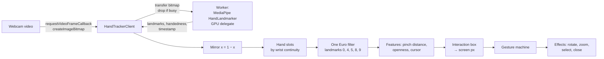
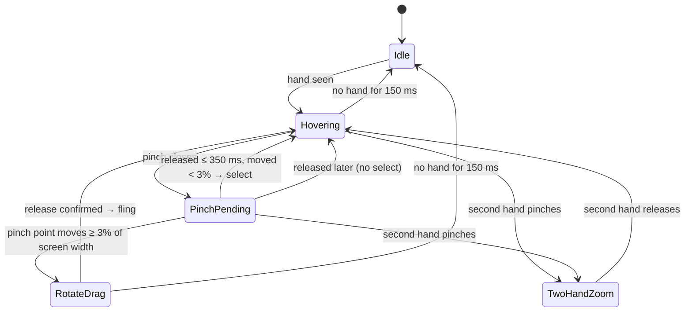

# GlobalGram

A gesture-controlled holographic globe that floats over your live webcam feed. Pinch and drag in the air to spin it, pull two hands apart to zoom, and tap event beacons to open a glass info panel, all in the browser with no backend.

Hand tracking runs on-device with MediaPipe in a Web Worker; the globe is rendered with React Three Fiber and composited over the camera so the room stays visible through it. Events are mocked (2,000 plausible news-style events) behind an `EventSource` interface, ready to swap for a real feed.

## Contents

- [Features](#features)
- [Quick start](#quick-start)
- [Using it](#using-it)
- [Debug tools](#debug-tools)
- [How it works](#how-it-works)
- [Project structure](#project-structure)
- [Configuration and tuning](#configuration-and-tuning)
- [Testing](#testing)
- [Performance notes](#performance-notes)
- [Troubleshooting](#troubleshooting)
- [Credits](#credits)

## Features

**Holographic globe**
- Fresnel-rim core sphere with screen-space scanlines and flicker, a 40,000-point dot-matrix landmass, graticule, optional atmosphere, and an emitter ring with rising particles.
- Bloom, chromatic aberration and film grain, composited over the webcam with brightness-derived alpha, so black is see-through and light sits on top of the room.
- Idle motion: a slow spin and gentle bob after 2 s without input.

**Event points**
- 2,000 mock events as whitish beams with hexagonal pins, faintly tinted by category (conflict, politics, disaster, economy, science, other). Beam height scales with importance.
- Beams grow in on load and animate between heights. Back-facing beams fade to 15% and can't be picked.
- Screen-space clustering that only changes with zoom, never with rotation. Clusters show a count badge, and selecting one zooms in until it splits.

**Hand interaction**
- MediaPipe HandLandmarker in a Web Worker on the GPU delegate, with frames dropped (never queued) while the worker is busy.
- One Euro filtering, an interaction box that maps the central 70% of the camera frame to the whole screen, and stable hand identity across frames.
- A pure, unit-tested gesture state machine for hover, pinch-tap, pinch-drag rotate with inertia, two-hand zoom and open-palm close.
- A magnetic reticle that locks onto nearby beams, shows lock brackets, and fills a progress ring as your fingers close.
- Pinch-tap or dwell-to-select, switchable at runtime.

**Info panel**
- A glass dispatch card with a category-coloured edge, importance, place and relative time, summary and source link (and an image when the event has one).
- It scales out of the selected point with a leader line. The globe turns the point centre-left so the panel never covers it.

**Mouse and keyboard fallback** for everything: drag, wheel, click, arrow keys, `+` / `-` and Escape.

**Debug tooling**
- Raw versus filtered hand skeletons and live pipeline readouts.
- Leva sliders for every visual and gesture parameter, plus the r3f-perf overlay.
- Landmark recording to JSON, and replay without a camera.

## Quick start

**Requirements**
- Node 20.19+ or 22.12+ (Vite 8's requirement) and [pnpm](https://pnpm.io).
- A Chromium-based browser (Chrome recommended) and a webcam.
- The page must be served over `localhost` or HTTPS for camera access.

```bash
pnpm install
pnpm dev
```

Open the printed URL (usually http://localhost:5173), then choose "Turn on camera" and allow camera access (or "Use mouse only").

`pnpm dev` and `pnpm build` first run `scripts/setup-mediapipe.mjs`, which:

- copies MediaPipe's ES-module WASM runtime from `node_modules` into `public/mediapipe/wasm`, and
- downloads the hand landmarker model (`hand_landmarker.task`, ~7.8 MB) into `public/mediapipe` the first time.

Both are served locally and gitignored. Run `pnpm assets` to do this step on its own.

### Scripts

| Command | What it does |
|---|---|
| `pnpm dev` | Prepare assets, start the Vite dev server |
| `pnpm build` | Prepare assets, type-check, production build to `dist/` |
| `pnpm preview` | Serve the production build |
| `pnpm test` / `pnpm test:watch` | Vitest unit tests |
| `pnpm lint` | ESLint |
| `pnpm typecheck` | `tsc -b` |
| `pnpm assets` | Copy MediaPipe WASM and download the model |

## Using it

### Hand gestures

Raise a hand in front of the camera. A ring (the reticle) follows your index fingertip.

| Gesture | How | Effect |
|---|---|---|
| **Point** | Move your index finger | The reticle follows; near a beam it locks on with corner brackets and shows the title |
| **Pinch-tap** | Pinch thumb and index, release quickly without moving | Select the locked beam: a single event opens its info panel, a cluster zooms in until it splits |
| **Pinch-drag** | Pinch, move, release | Rotate the globe: horizontal spins, vertical tilts (±60°); a flick keeps coasting |
| **Two-hand zoom** | Both hands up, pinch with the second hand, spread or close | Spreading zooms in, closing zooms out |
| **Open palm** | Hold a flat hand, thumb spread, for 300 ms | Close the info panel |
| **Dwell** *(optional mode)* | Hold the reticle on a beam for 600 ms | Select it without pinching (enable in **D → Selection → mode**) |

Tips:

- The ring around the reticle fills as your fingers close, so you can see a tap coming. Whatever is locked when the pinch starts is what gets selected, even if pinching nudges your hand.
- The central 70% of the camera frame covers the whole screen (the dashed box in debug mode), so you don't have to reach to the edges of the camera view.
- Pinch detection adapts to your hand's resting pose, so pinching with the other fingers curled works as well as an OK-sign pinch.

### Mouse and keyboard

| Input | Effect |
|---|---|
| Drag | Rotate (with inertia) |
| Wheel | Zoom |
| Click | Select a beam / zoom into a cluster |
| Arrow keys | Rotate |
| `+` / `-` | Zoom |
| `Esc` | Close the info panel (or the Gestures sheet, if open) |
| `H` or `?` | Open the Gestures sheet |
| `D` | Toggle debug mode |

### Onboarding and the coach

On a first visit the app explains the camera before the browser prompts for it; "Use mouse only" skips it. If the browser already granted camera access, the camera starts directly. A subtitle-style caption at the bottom (top on narrow screens) reports status (loading events, loading hand tracking, camera errors) and teaches each gesture in context. A tip retires once you have done that gesture, remembered in `localStorage` under `globalgram.coach`. The Gestures button (bottom right) opens a full guide with the category colour legend and a way to turn the camera on later.

## Debug tools

Press **D** to toggle:

- **Readouts:**
  - tracker status and delegate, and the WebGL renderer MediaPipe runs on;
  - tracking fps, inference time and capture-to-result latency;
  - hand count, gesture phase, pinch distance, pinching flag, openness, cursor position and speed;
  - the hovered event id.
- **Skeletons:** raw (grey) and One Euro–filtered (cyan) landmarks drawn over the video, with the interaction box and cursor.
- **Leva panel:** live sliders for every visual and gesture parameter (see [Configuration](#configuration-and-tuning)).
- **r3f-perf:** frame rate, draw calls, triangles and points for the scene.

### Recording and replaying hand data

With debug mode on:

| Key | Action |
|---|---|
| `R` | Start recording; press again to stop and download `landmarks-<timestamp>.json` |
| `L`, or drag a recording onto the window | Replay it in place of the camera, looping |
| `P` | Stop replaying and return to the live camera |

Recordings hold the raw tracker output (21 landmarks per hand, handedness, timestamps, inference time), not video. Replay feeds them through the full pipeline: filtering, pinch detection and the gesture machine. That lets you reproduce and tune gesture behaviour without a camera, or share a problem as a file. Recordings in the project root are gitignored.

## How it works

### Render layers

Three full-screen layers, back to front:

1. **Camera:** a mirrored `<video>` at 1280×720 / 30 fps, `object-fit: cover`, dimmed to 70% brightness.
2. **3D canvas:** a transparent R3F `<Canvas>`. A final post-processing pass sets each pixel's alpha from its brightness, so the premultiplied canvas composites as `rgb + video × (1 − alpha)`.
3. **HUD (DOM):** reticle, labels, info panel and debug overlay. They're positioned from projected 3D coordinates after every rendered frame, without React re-renders.

The globe group rotates; the camera only dollies in and out.

### Hand pipeline



- **Worker:** HandLandmarker in VIDEO mode, 2 hands, 0.6 confidences, GPU delegate on an `OffscreenCanvas`. It refuses software WebGL renderers rather than silently running on the CPU.
- **Hand identity:** detected hands are matched to the previous frame by wrist position, not by MediaPipe's Left/Right label, which flickers on real hands.
- **Filtering:** One Euro (`minCutoff 1.0`, `beta 0.02`, `dCutoff 1.0`), applied in on-screen pixel units so its parameters act on visible jitter.
- **Features:**
  - **Pinch distance:** thumb-tip to index-tip, in palm lengths (wrist → middle MCP), measured from raw landmarks so quick taps aren't smoothed away.
  - **Openness:** mean fingertip reach, mapped to 0 (fist) – 1 (flat hand).
  - **Cursor:** the pinch midpoint while pinching, otherwise the index tip.
- **Pinch detection:** relative to the hand's own resting thumb–index distance, capped at the classic thresholds (start below 0.25, end above 0.40).
- **Hand loss:** a missing hand holds its last state for 150 ms before it counts as gone.

### Gesture state machine

`core/gestures/gestureMachine.ts` is a pure function, `(state, frame) → (state, effects)`. Effects are applied by `useGestureController`; the machine never touches the globe.



Rules that keep it reliable:

- **Pinch onset:** a pinch only starts when the fingers close, so finishing a zoom with the main hand still pinched can't fire a tap.
- **Confirmed release:** a drag ends only when the pinch opens past 0.40 or stays open for 120 ms, so a single noisy frame never cuts a rotation.
- **Inertia:** measured over the last 200 ms of the drag, then decays ×0.92 per 60 Hz frame. Slow releases don't fling.
- **Prediction:** while dragging, the render loop extrapolates up to 80 ms ahead at the drag's speed, so ~10–30 Hz tracking still rotates smoothly at 60 fps.
- **Open palm:** fires once per opening and needs the thumb spread, so a relaxed open hand doesn't trigger it.

### Picking

- **Screen cache:** beams are projected to screen-space segments (base → pin). The cache is recomputed only when the globe or camera moves, the clusters change, or beams are still growing.
- **Snap:** the reticle locks onto the nearest front-facing beam within 48 px. Another beam must be 12 px closer to take the lock, and the lock freezes while a pinch is pending.
- **Clustering:** done on the sphere. A 36 px screen radius is converted to an angle at the current zoom, so rotation never reshuffles clusters; they are recomputed in 4% zoom steps.

## Project structure

Four layers with one-way dependencies:

- **`core/`**: pure TypeScript with no React, three.js or DOM imports. Unit tests sit next to each file.
- **`infrastructure/`**: the only code touching `getUserMedia`, MediaPipe and event sources.
- **`store/`**: one zustand store per concern, holding state and setters only. Render loops read them with `getState()`, so hot-path data never goes through React state.
- **`features/`**: React/R3F. Components render, hooks orchestrate, and each feature owns its materials and shaders.

`features` may use `store`, `core`, `infrastructure` and `shared`. `store` uses only `core` types, and `core` imports nothing outside itself. Features depend on the `EventSource` interface, never on `MockEventSource`.

```
src/
  app/              App.tsx (composition root), main.tsx, useRenderDpr.ts
  core/
    clustering/     screenClusters
    events/         GlobeEvent, beamHeight, relativeTime
    geo/            latLngToVector, screenProjection, landSampling, graticule
    gestures/       GestureState, gestureMachine, thresholds
    hands/          HandFrame, oneEuroFilter, handFeatures, handSlots,
                    pinchDetector, interactionBox
    math/           random (seeded PRNG)
    motion/         orbit, inertia, spawn, idleMotion
    picking/        magneticSnap
  infrastructure/
    camera/         WebcamStream
    handTracking/   handTracker.worker, HandTrackerClient, protocol
    events/         EventSource (interface), MockEventSource, mockEventData
  store/            globe, event, selection, gesture, hand, projection, debug, replay
  features/
    camera/         CameraLayer
    globe/          GlobeScene, CoreSphere, Landmass, Graticule, Atmosphere,
                    ProjectionRing, useGlobeTransform, useIdleMotion, materials/, shaders/
    eventPoints/    EventPoints, Beams, BaseRings, Pins, EventLabels,
                    useClusters, useScreenCache, useEventFeed, materials/, shaders/
    handInput/      useHandTracking, useGestureController, useMouseFallback
    selection/      Reticle, useMagneticPicking, PickingController, selectionActions
    infoPanel/      InfoPanel, LeaderLine, TypingText, usePanelAnchor
    postprocessing/ Effects, AlphaFromBrightnessEffect
    debug/          DebugOverlay, DebugReadouts, LandmarkSkeleton, PerfMonitor,
                    landmarkRecorder, landmarkReplayer
  shared/
    config/         visualConfig, gestureConfig (leva-bound), levaBinding
    ui/             GlassPanel
    frameOrder.ts   useFrame priorities
scripts/
  build-land-mask.mjs     Natural Earth polygons → public/land-mask.png
  setup-mediapipe.mjs     MediaPipe WASM + model → public/mediapipe
```

### Plugging in real events

Implement the interface in `infrastructure/events/EventSource.ts`:

```ts
export interface EventSource {
  fetchEvents(): Promise<GlobeEvent[]>
}
```

Then swap `new MockEventSource()` for your source in `app/App.tsx`, the only place a concrete source is chosen.

`GlobeEvent` is defined in `core/events/GlobeEvent.ts`:

```ts
type GlobeEvent = {
  id: string
  lat: number
  lng: number
  category: 'conflict' | 'politics' | 'disaster' | 'economy' | 'science' | 'other'
  importance: number // 0..1
  title: string
  summary?: string
  imageUrl?: string
  sourceUrl?: string
  timestamp: string // ISO 8601
}
```

### Regenerating the land mask

`public/land-mask.png` is a 2048×1024 equirectangular raster of Natural Earth's public-domain 50m land polygons:

```bash
curl -sSLo ne_50m_land.geojson \
  https://raw.githubusercontent.com/nvkelso/natural-earth-vector/master/geojson/ne_50m_land.geojson
node scripts/build-land-mask.mjs ne_50m_land.geojson public/land-mask.png 2048
```

## Configuration and tuning

All tunables live in two plain objects that render loops read every frame. Leva's sliders write straight into them, so tuning never re-renders React.

- **`shared/config/visualConfig.ts`:** Palette, Core sphere, Landmass, Graticule, Atmosphere, Event colours, Event points, Pin heights, Projection ring, Post, Motion. Also `RENDER_QUALITY` (render resolution budget) and fixed geometry constants.
- **`shared/config/gestureConfig.ts`:** One Euro filter, Interaction box, Selection mode (pinch or dwell) and dwell time.

Slider changes last until reload. To keep values, copy them into these files' defaults.

Gesture thresholds are constants in `core/gestures/thresholds.ts`, documented inline:

| Threshold | Value |
|---|---|
| Pinch start / end caps | 0.25 / 0.40 |
| Tap window | 350 ms |
| Drag start | 3% of screen width |
| Release confirmation | 120 ms |
| Hand-loss grace | 150 ms |
| Open palm | openness > 0.9, thumb spread > 0.7, held 300 ms |
| Dwell | 600 ms |

## Testing

```bash
pnpm test
```

150 unit tests cover the pure core:

- **Gesture machine:**
  - tap vs drag, and slow drags;
  - pinch hysteresis and noisy releases;
  - hand loss mid-drag and mid-zoom;
  - two-hand transitions and open palm;
  - a "10 rotations in a row" reliability run with simulated jitter and dropped frames.
- **Hand processing:** One Euro filter (jitter suppression and lag), relative pinch detection, hand slots, features, interaction box with cover cropping.
- **Geometry and picking:** projection, clustering and split distances, magnetic snapping, inertia and prediction, land sampling, and the deterministic mock event generator.

## Performance notes

Targets: 60 fps rendering, ~30 fps tracking, at most 80 ms hand-to-response latency, at most 30 draw calls, and 2,000 events without frame drops. The scene uses about 25 draw calls.

- **GPU sharing:** the hand tracker and the scene share the GPU, and MediaPipe waits on it every inference. Rendering a Retina window at 2× with 4× MSAA once starved tracking to ~2 fps. `RENDER_QUALITY` therefore caps the pixel ratio at 1.5 **and** at a total pixel budget (~3.6 M device pixels), so large screens drop towards 1× automatically, and uses 2× MSAA.
- **Never wait on the tracker:** the render loop always reads the latest state and interpolates. Tracking results arrive asynchronously, and frames are dropped, never queued, while the worker is busy.
- **Cheap hot paths:** clustering is recomputed only on zoom steps, and the screen cache only when the view changes. HUD elements are positioned imperatively after each frame.

## Troubleshooting

| Symptom | Check |
|---|---|
| "Camera access was blocked" | Allow the camera in the address bar and reload; the page must be on `localhost` or HTTPS |
| Tracker shows an error | The message names the cause. "Software-rendered" means Chrome has no GPU acceleration: check `chrome://gpu` |
| Tracking fps is low (see `tracking` readout) | Close other GPU-heavy tabs; make the window smaller; lower `RENDER_QUALITY` in `visualConfig.ts` |
| Cursor jitters | D → One Euro filter: lower `minCutoff` for a steadier rest, raise `beta` to reduce lag when moving |
| Taps not registering / accidental taps | Record a session (D → R) and replay it (D → L) to see the `gesture` phase and `pinchDist` frame by frame |
| Open palm doesn't close the panel | Check that your flat palm reads `openness` above 0.9 and `pinchDist` above 0.7 in the readouts |
| r3f-perf shows GPU 0.000 ms | Expected: it only times the scene's own render calls and can't see the tracker's worker |

## Credits

- **Land data:** [Natural Earth](https://www.naturalearthdata.com/), public domain.
- **Hand tracking:** [MediaPipe Tasks Vision](https://ai.google.dev/edge/mediapipe/solutions/vision/hand_landmarker) and its hand landmarker model, Apache License 2.0.
- **Rendering:** [three.js](https://threejs.org/), [React Three Fiber](https://r3f.docs.pmnd.rs/), [@react-three/postprocessing](https://github.com/pmndrs/react-postprocessing).
- **State and tooling:** [zustand](https://github.com/pmndrs/zustand), [leva](https://github.com/pmndrs/leva), [r3f-perf](https://github.com/utsuboco/r3f-perf), [vite-plugin-glsl](https://github.com/UstymUkhman/vite-plugin-glsl), [Vite](https://vite.dev/), [Vitest](https://vitest.dev/), [Tailwind CSS](https://tailwindcss.com/).
- **Filtering:** One Euro filter by Casiez, Roussel and Vogel (CHI 2012).

All events shown are generated mock data. Titles, summaries and source links are fictional.
